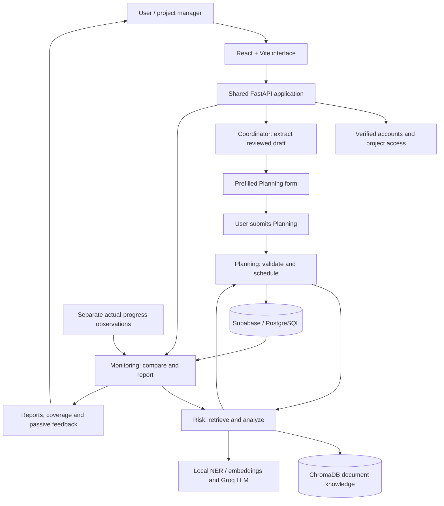

# APM — Agentic Project Management System

APM is a web-based project management decision-support system developed for IRWA. It helps users turn reviewed requirements into schedules, retrieve project knowledge, identify evidence-supported risks, and compare actual progress with a saved plan.

Four specialist agents divide the work: **Coordinator & Decision**, **Planning & Scheduling**, **Risk & Knowledge Retrieval**, and **Monitoring & Reporting**. Language models assist with task proposals and risk analysis; validated code handles scheduling and progress calculations. Users remain responsible for reviewing recommendations and approving project commitments.

## Contents

- [Features and current status](#features-and-current-status)
- [Architecture](#architecture)
- [Technology stack](#technology-stack)
- [Repository structure](#repository-structure)
- [Prerequisites](#prerequisites)
- [Local setup](#local-setup)
- [Configuration reference](#configuration-reference)
- [Using the application](#using-the-application)
- [API overview](#api-overview)
- [Testing and validation](#testing-and-validation)
- [Security and responsible AI](#security-and-responsible-ai)
- [Limitations and roadmap](#limitations-and-roadmap)
- [Troubleshooting](#troubleshooting)
- [Documentation and contribution](#documentation-and-contribution)

## Features and current status

| Component | Current capability | Important boundary |
| --- | --- | --- |
| Coordinator | Structured input, rule-based extraction of explicit names, ISO dates and team counts, editable drafts, and handoff to Planning | Continuing to Planning prefills its form; it does not submit or save a schedule. General autonomous agent routing remains future work. |
| Planning | Supplied or generated tasks, labelled fallback templates, dependency validation, date calculations, critical-path information, Risk integration, and saved schedules | Resource capacity is not scheduled. Generated estimates require review. |
| Risk & Knowledge | PDF ingestion, cleaning, NER, overlapping chunks, embeddings, project-filtered semantic retrieval, duplicate detection, document management, and model-assisted risk analysis | Evidence can be incomplete or incorrect. Several analysis endpoints still need service authentication and project grants. |
| Monitoring | Registered shared API and React page, baseline reads, separate actual observations, missing/stale coverage, progress reports, optional Risk context, and saved report/observation workflows | Persistence needs manually configured tables. Feedback and exports are passive artifacts, not an autonomous rescheduling loop. |
| Accounts and access | Username/password signup, common user/admin sign-in, verified JWT sessions, profile display, and single-owner project access | App-managed accounts are not Supabase Auth users. Multi-member project collaboration is not implemented. |

These capabilities describe the repository implementation. A build, a health response, or code presence does not establish successful live database setup or complete production readiness.

## Architecture

The normal development setup runs **one FastAPI backend and one React frontend**. There is no need to run a separate server for each agent.



Agent communication uses Pydantic models, JSON, HTTP clients, and service/provider adapters. Project and task identifiers connect records; they do not grant access by themselves. Shared Monitoring reads Planning through an owner-filtered repository adapter and invokes Risk through an in-process ASGI transport. Planning uses its configured Risk HTTP endpoint.

### Knowledge retrieval pipeline

```text
PDF -> extract text -> clean -> NER / overlapping chunks
    -> normalized sentence embeddings -> ChromaDB + source metadata

Query -> embed -> filter by project -> rank by cosine similarity
      -> retrieve evidence -> structured LLM risk analysis -> human review
```

The embedding service defaults to `all-MiniLM-L6-v2`; NER defaults to `dslim/bert-base-NER`. Retrieved similarity scores indicate relevance, not risk probability or factual correctness. Optional PostgreSQL retrieval adds project-bound planning context.

## Technology stack

| Layer | Technologies |
| --- | --- |
| Frontend | React, Vite, React Router, JavaScript/JSX, CSS, Axios, Recharts |
| API and contracts | Python, FastAPI, Uvicorn, Pydantic |
| AI and NLP | Groq API, Transformers, Sentence Transformers, local pretrained NER and embedding models |
| Document processing | PyMuPDF, text normalization, overlapping character chunks |
| Data | Supabase/PostgreSQL for structured records; persistent ChromaDB for document vectors |
| Security | JWT verification, PBKDF2-SHA256 password hashing, project ownership checks, backend service credentials |
| Validation | Pytest, Node's built-in test runner, ESLint, Vite production build |

Backend dependencies are pinned in [backend/requirements.txt](backend/requirements.txt). Frontend dependencies and scripts are defined in [frontend/package.json](frontend/package.json), with resolved versions in [frontend/package-lock.json](frontend/package-lock.json).

## Repository structure

```text
APM/
├── backend/
│   ├── app/
│   │   ├── agents/
│   │   │   ├── coordinator/       # Extraction and Planning gateway
│   │   │   ├── planning/          # Task generation and scheduling
│   │   │   ├── risk_knowledge/    # Document-grounded risk analysis
│   │   │   └── monitoring/        # Actuals, analysis, reports and storage
│   │   ├── api/                  # Account, auth, Planning and Risk routers
│   │   ├── communication/        # Agent messages and protocols
│   │   ├── core/                 # Configuration, identity and project access
│   │   ├── model/                # Planning data contracts
│   │   ├── repository/           # Schedule persistence
│   │   ├── services/             # NLP, retrieval, LLM and shared business logic
│   │   └── main.py               # Shared FastAPI entry point
│   ├── sql/                      # Planning, accounts and ownership SQL
│   ├── tests/                    # Backend integration/component tests
│   ├── .env.example              # Minimal configuration template
│   └── requirements.txt
├── frontend/
│   ├── src/
│   │   ├── admin/                # Administrator screens
│   │   ├── components/           # Shared navigation and UI
│   │   ├── pages/                # Coordinator, Planning, Schedule, Monitoring, etc.
│   │   └── services/             # API/session clients and client tests
│   ├── package.json
│   └── vite.config.js            # Development proxy configuration
├── docs/                         # Architecture, access contracts and study material
├── data/                         # Repository data directory
├── setup.ps1                     # Historical scaffold-generation script
└── README.md
```

Configured runtime paths such as `data/chroma` and `data/documents` are relative to the backend's working directory by default. Start the shared backend from `backend/`. `setup.ps1` is a historical scaffold script, not the application installer or database migration runner.

## Prerequisites

- **Python 3.13+**, following the repository development baseline, with support for the pinned dependencies. Package/native-library compatibility must be verified for the selected interpreter and platform.
- **Node.js 22.13+ within the 22.x line, or Node.js 24+**, with npm. These choices satisfy both Vite and ESLint engine requirements recorded in the lockfile.
- A **Supabase project** and a trusted backend key with the required `service_role` privileges.
- A **Groq API key** and access to the configured model, including the structured-output support used by Risk and optional Monitoring summarization.
- Network access for package installation, pretrained-model downloads, Supabase and Groq. Local NLP models may need substantial download space and initialization time.
- Git for repository collaboration.

The instructions below use PowerShell. On other platforms, use the corresponding virtual-environment executable under `venv/bin/`.

## Local setup

### 1. Install backend dependencies

From the repository root:

```powershell
cd backend
```

Create an environment only if `backend/venv` does not already exist:

```powershell
python -m venv venv
```

Then install into that isolated environment:

```powershell
.\venv\Scripts\python.exe -m pip install -r requirements.txt
```

Using the environment's executable avoids requiring PowerShell activation. Do not recreate an existing environment merely to restart the application.

### 2. Configure the backend

For a fresh checkout without `backend/.env`, copy the example:

```powershell
Copy-Item -LiteralPath .env.example -Destination .env
```

Preserve an existing `.env`. The example contains only the Supabase and Groq fields; add the authentication settings below privately. Replace every placeholder with real operator-managed values before starting:

```dotenv
SUPABASE_URL=https://<your-project>.supabase.co
SUPABASE_SECRET_KEY=<private-backend-key>
GROQ_API_KEY=<private-groq-key>
GROQ_MODEL=openai/gpt-oss-120b

ADMIN_USERNAME=<your-admin-username>
ADMIN_PASSWORD_HASH='<your-salted-pbkdf2-hash>'
JWT_SECRET_KEY=<cryptographically-random-signing-key>
JWT_ALGORITHM=HS256
JWT_ISSUER=apm
JWT_AUDIENCE=apm-admin
ACCOUNT_JWT_AUDIENCE=apm-accounts
ACCESS_TOKEN_EXPIRE_MINUTES=60
```

Generate administrator password hashes and signing material using the private-terminal instructions in [Authentication and authorization](docs/AUTHENTICATION.md#operator-setup). For HS256, signing material must be at least 32 UTF-8 bytes with adequate randomness. Configure your own administrator credentials rather than relying on a source-code default. Keep hashes quoted in dotenv files so `$` characters remain literal. Account and administrator audiences must differ.

`PLANNING_API_KEY` is an additional private credential for trusted backend/service calls. It is not required by the normal signed-in browser workflow and must never be placed in a `VITE_*` variable.

### 3. Prepare the database

Use a trusted Supabase SQL/migration connection. Review existing objects and back up data as appropriate before applying changes. For a new database, apply in this order:

| Order | SQL file | Purpose |
| --- | --- | --- |
| 1 | [backend/sql/schema.sql](backend/sql/schema.sql) | `project_schedules`, indexes and update timestamp trigger |
| 2 | [backend/sql/auth_accounts.sql](backend/sql/auth_accounts.sql) | App-managed accounts, administrator invitations and restricted account RPCs |
| 3 | [backend/sql/project_ownership.sql](backend/sql/project_ownership.sql) | Nullable owner UUID and restricted schedule table privileges |
| 4 | [Monitoring SQL](backend/app/agents/monitoring/monitoring_reports.sql) | `monitoring_reports` and `monitoring_observations` for saved Monitoring workflows |

Accounts and ownership scripts are **one-time additive migrations**, not reset commands. If their objects already exist, use a reviewed in-place migration rather than rerunning `CREATE TABLE`/`ADD COLUMN` statements or dropping data. The application does not apply these scripts on startup.

Verify table privileges, REST exposure, backend access and RLS independently. RLS enablement alone is not a complete authorization policy. App-managed accounts live in `public.auth_accounts`, not Supabase Auth's `auth.users`.

Existing schedules remain unassigned after the ownership migration and are hidden from ordinary users. A verified administrator can assign an unassigned schedule through the preserved owner-assignment API; the administrator dashboard does not provide an ownership panel.

### 4. Start the shared backend

From `backend/`:

```powershell
.\venv\Scripts\python.exe -m uvicorn app.main:app --reload --host 127.0.0.1 --port 8000
```

| Service | Local URL |
| --- | --- |
| Backend | <http://127.0.0.1:8000> |
| Swagger/OpenAPI UI | <http://127.0.0.1:8000/docs> |
| ReDoc | <http://127.0.0.1:8000/redoc> |
| Basic health | <http://127.0.0.1:8000/health> |
| Monitoring configuration health | <http://127.0.0.1:8000/api/monitoring/health> |

Risk initializes local models and services as part of shared application loading. Planning fallbacks do not guarantee successful startup when those dependencies are unavailable. Monitoring health is configuration-only and explicitly does not verify live sources or database writes.

### 5. Start the frontend

Open another terminal, starting from the repository root:

```powershell
cd frontend
npm ci
npm run dev
```

Skip installation when dependencies are already installed and unchanged. Open the origin printed by Vite, normally <http://localhost:5173>.

Vite proxies `/api/auth`, `/api/accounts`, `/api/coordinator`, `/api/planning`, `/api/risk` and `/api/monitoring` to the backend on port 8000. Its development proxy is not shipped with production builds.

## Configuration reference

Configure backend values in private `backend/.env` or the process environment. Process environment overrides file values. Restart the backend after changes.

| Variable | Default / purpose |
| --- | --- |
| `SUPABASE_URL`, `SUPABASE_SECRET_KEY` | Required shared backend storage configuration; trusted backend key only |
| `GROQ_API_KEY`, `GROQ_MODEL` | External inference; default model `openai/gpt-oss-120b` |
| `ADMIN_USERNAME`, `ADMIN_PASSWORD_HASH` | Configured administrator identity and preferred password hash |
| `JWT_SECRET_KEY`, `JWT_ALGORITHM` | Private signing material; algorithm defaults to `HS256` |
| `JWT_ISSUER`, `JWT_AUDIENCE`, `ACCOUNT_JWT_AUDIENCE` | Defaults `apm`, `apm-admin`, `apm-accounts` |
| `ACCESS_TOKEN_EXPIRE_MINUTES` | Default 60; supported range 1–1,440 |
| `PLANNING_API_KEY` | Optional backend-only service credential; absence does not make service endpoints public |
| `RISK_AGENT_URL`, `RISK_AGENT_TIMEOUT` | Planning's Risk server root and timeout; defaults `http://localhost:8000` and 60 seconds |
| `CHROMA_PERSIST_DIRECTORY`, `CHROMA_COLLECTION_NAME` | Defaults `data/chroma`, `project_knowledge` |
| `UPLOAD_DIRECTORY`, `MAX_UPLOAD_SIZE_MB` | Defaults `data/documents`, 10 MB |
| `POSTGRES_DATABASE_URL`, `POSTGRES_SEARCH_LIMIT` | Optional direct PostgreSQL knowledge connection; default search limit 20 |
| `CORS_ORIGINS` | Comma-separated frontend origins; local 5173/3000 origins are defaults |
| `MONITORING_LLM_ENABLED` | Default `true`; `false` disables Monitoring's optional Groq fact selection, not Risk inference |
| `MONITORING_RISK_FAILURE_POLICY` | Default `fail`; `report_unknown` permits unavailable Risk coverage with warnings |
| `MONITORING_PROVIDER_TIMEOUT_SECONDS` | Default 30; positive finite value up to 300 |
| `SUPABASE_MONITORING_REPORTS_TABLE` | Default `monitoring_reports` |
| `SUPABASE_MONITORING_OBSERVATIONS_TABLE` | Default `monitoring_observations` |

`ADMIN_PASSWORD` is a legacy compatibility path when no hash is configured; prefer `ADMIN_PASSWORD_HASH`. An explicitly malformed/empty hash fails closed.

Frontend clients normally use same-origin `/api` URLs. Optional `VITE_API_BASE_URL` must be a server root without credentials, paths, queries or fragments; use HTTPS outside loopback. If you change `ACCOUNT_JWT_AUDIENCE`, align the non-secret frontend `VITE_ACCOUNT_JWT_AUDIENCE`. Every `VITE_*` value is browser-visible: never use it for passwords, signing keys, model keys or database/service secrets.

The optional standalone Monitoring application has separate scoped-token/provider settings. It is not the normal group-project entry point. See the [Monitoring README](backend/app/agents/monitoring/README.md) for that compatibility mode and advanced configuration.

## Using the application

### Sign in and capture requirements

1. Open `/signup` to register an ordinary account, then `/login` to sign in. Configured administrators also use `/login`.
2. Open **Coordinator** and enter structured details or a natural-language description.
3. Review extracted fields. Only explicitly supported patterns and `YYYY-MM-DD` dates are recognized; relative dates need manual entry.
4. Choose **Continue to Planning** to prefill its form. Review the draft again before submitting.

### Generate and review a schedule

1. Confirm project identity, objective, start/deadline, resources and any supplied tasks.
2. Submit Planning. If tasks are absent, it can request model-generated tasks or use a labelled fallback template.
3. Review dependencies, duration assumptions, deadline analysis and warnings. Planning rejects invalid dependency graphs.
4. Inspect Risk evidence and recommendations. Planning owns schedule changes and can apply valid findings during this workflow.
5. Open **Schedule** to inspect saved projects. Ordinary users see their own projects; administrators can access all.

If Risk is unavailable or its findings cannot be applied, Planning retains the initial valid schedule with a warning where supported. This does not mean that risks were checked successfully. Successful generation still requires successful persistence to be reported as saved.

### Manage project knowledge

Administrators use knowledge-management screens/APIs to upload PDFs, inspect indexed documents/chunks, search and delete knowledge. Uploads have configured size and PDF filename checks; those checks do not establish malware scanning. Image-only PDFs require OCR support that the current extraction path does not provide.

### Monitor actual progress

1. Open **Monitoring** or **Monitor progress** from a saved schedule.
2. Select an accessible project and read its baseline.
3. Record separate actual observations with genuine task status, percentage and dates. Planned dates are not actual observations.
4. Review missing/stale data and optional Risk coverage before generating a report.
5. Explicitly save observations/reports when persistence is needed and the tables are configured. Review saved records or export passive artifacts.

Reports can classify projects as `ON_TRACK`, `AT_RISK` or `DELAYED` under configured rules. Missing coverage remains visible. Monitoring's optional model selects existing verified fact IDs; deterministic reporting can be used if that selection fails.

Tokens remain in React memory. Refresh requires sign-in again. Sign-out clears browser state but does not revoke an already issued JWT on the server. Cancelling a browser request does not roll back work already completed on the backend.

## API overview

Swagger at `/docs` is the source for request/response schemas. The following summarizes registered route families rather than every compatibility endpoint.

| Routes | Purpose | Access contract |
| --- | --- | --- |
| `/api/accounts/signup`, `/login`, `/session` | Registration, account login and session verification | Public registration/login; verified bearer for session |
| `/api/auth/login`, `/session` | Administrator login/session | Configured or managed administrator credentials/session |
| `/api/coordinator/interpret` | Natural-language extraction | Verified account/admin bearer |
| `/api/coordinator/request` | Backend Coordinator-to-Planning path | Private Planning service key |
| `/api/planning/schedule`, `/schedule/{project_id}`, `/schedules` | Create, read, update, delete and list schedules | Owner account; administrator or trusted service access |
| `/api/planning/schedule/{project_id}/owner` | Assign project owner | Verified administrator |
| `/api/planning/message` | Agent/service message processing | Private Planning service key only |
| `/api/risk/documents`, `/knowledge/search`, `/knowledge/documents/...` | PDF ingestion and knowledge management | Administrator bearer |
| `/api/risk/analyse`, `/analyse-plan`, `/agent/plan` | Risk analysis source contracts | Currently public; unresolved production authorization boundary |
| `/api/monitoring/session` | Authorized projects and permissions | Verified shared user/admin identity |
| `/api/monitoring/projects/{project_id}/baseline` | Planning baseline | Fresh project access plus Monitoring read permission |
| `/api/monitoring/projects/{project_id}/observations...` | Validate/save/read actual observations | Fresh project access; generate permission for submission, read for retrieval |
| `/api/monitoring/reports`, `/projects/{project_id}/reports...` | Generate/save/read/export reports | Fresh project access and operation-specific permissions |

Backend authorization is authoritative. Browser routing, sender labels, loopback origins, CORS and supplied project IDs are not substitutes for permission checks.

## Testing and validation

Use the existing isolated environment. The focused suites below use synthetic configuration, fake databases and mocked transports; they do not verify real credentials, migrations, live providers or browser end-to-end behavior.

### Account, authorization and shared integration tests

From `backend/`:

```powershell
.\venv\Scripts\python.exe -B -m pytest tests/test_accounts.py tests/test_auth.py tests/test_project_authorization.py tests/test_planning_ownership_api.py tests/test_planning_ownership_repository.py tests/test_monitoring_account_access.py tests/test_coordinator_access.py -p no:cacheprovider
```

### Monitoring component tests

From `backend/`:

```powershell
.\venv\Scripts\python.exe -B -m pytest app/agents/monitoring/tests -p no:cacheprovider
```

Other agent/component tests are under `backend/tests/`. Review their fixtures and external-service/configuration assumptions before running the entire directory against a developer environment.

### Frontend client and navigation tests

From `frontend/`:

```powershell
node --test src/services/accountApi.test.js src/services/adminApi.test.js src/services/signInApi.test.js src/services/planningApi.test.js src/services/monitoringApi.test.js src/services/monitoringView.test.js src/services/accountMonitoring.test.js src/services/coordinatorApi.test.js src/services/profileView.test.js src/components/navigation.test.js
npm run lint
npm run build
```

`npm run preview` previews the built frontend; it does not start FastAPI or reproduce Vite's development proxy. For a build that avoids reading application environment files, follow the environment-isolated validation instructions in [Authentication and authorization](docs/AUTHENTICATION.md#offline-validation).

Report test results with the environment and scope checked. No project-wide accuracy, latency, fairness or user-satisfaction percentage is established by these commands alone.

## Security and responsible AI

### Implemented safeguards

- Server-side JWT validation checks signatures, accepted algorithms, issuer/audience, purpose and time claims. Managed sessions also check fresh account state and stored role.
- Ordinary Planning and shared Monitoring operations enforce stored project ownership. Public registration cannot request an administrator role.
- Passwords use salted PBKDF2-SHA256 hashing; privileged database/model/service credentials stay on the backend.
- Pydantic contracts and dependency checks constrain data before scheduling or reporting.
- Risk prompts distinguish retrieved data from instructions, facts from inferences, and unavailable evidence from confirmed claims.
- Reviewable inputs, fallback notices, evidence references and missing/stale coverage support human oversight.
- Login has bounded bodies, sanitized responses and a process-local request limiter.

### Remaining deployment boundaries

Risk analysis source APIs can retrieve project knowledge and invoke paid inference without the complete service/project authorization boundary. Agree and implement those contracts before broader exposure. Administrator login and owner checks elsewhere do not secure these endpoints automatically.

Production also needs verified database privileges, HTTPS/proxy configuration, shared rate limiting and inference quotas, upload hardening, backup/recovery, retention/deletion rules, approved PostgreSQL source tables, and an intentional session/revocation policy. Keep development loopback-only or behind a trusted access-controlled boundary until these contracts are secured. See [Authentication and authorization](docs/AUTHENTICATION.md) for exact access boundaries.

PDF extraction, NER and embeddings run locally, but selected project information/evidence is sent to Groq for model-assisted analysis. Minimize confidential content and establish appropriate external-processing terms. Vectors and generated reports are sensitive derived data too.

RAG and schema validation reduce some errors but do not guarantee truth or defeat prompt injection. Verify sources, review generated estimates and test bias across comparable inputs. Confidence fields and similarity scores are not calibrated correctness probabilities. Complete fairness evaluation and a persisted cross-agent audit trail remain future work.

## Limitations and roadmap

| Current limitation | Planned direction |
| --- | --- |
| Conservative name/date/resource extraction | Broader language/date support with measured fidelity and field provenance |
| Reviewed draft passed through navigation state | Persistent access-controlled drafts |
| Serial task placement; no resource-capacity optimization | Validated parallel scheduling, calendars and capacity constraints |
| Heuristic/model-generated estimates and confidence | Historical validation, estimate review and calibrated uncertainty |
| Retrieval coverage, model input windows and image-only PDFs | Better chunking/versioning, retrieval evaluation and tested OCR |
| Incomplete Risk source authorization | Explicit service identity and project grants/delegation |
| Single-owner project model | Deliberate memberships and project roles |
| Shared startup/model dependencies | Lazy loading, optional-service isolation and readiness checks |
| Passive Monitoring delay feedback | Reviewed, versioned rescheduling rather than an unvalidated automatic loop |
| Limited measured quality/usability evidence | Representative datasets, failure tests and recorded user trials |

The commercialization proposal in project study material uses illustrative subscription prices. Billing, enforced plan quotas and paid team memberships are not implemented product features.

## Troubleshooting

| Symptom | What to check |
| --- | --- |
| Missing Supabase configuration / startup failure | Run from `backend/`; configure its private `.env`; verify model packages/downloads and Groq setup. |
| Account signup or project storage unavailable | Confirm the relevant manual SQL migrations, restricted RPC/table privileges and trusted backend key. No local account fallback is provided. |
| Authentication returns 503 | Check signing-key requirements, audience separation and administrator hash configuration without printing secret values. |
| Project is absent or returns 404 | Verify the current account owns it. Legacy/service/admin-created projects can be unassigned; entering an ID does not grant access. |
| Monitoring chooser omits a legacy project | Monitoring identifiers must match `[A-Za-z0-9][A-Za-z0-9_.-]{0,99}`; unsupported IDs are not automatically renamed. |
| Monitoring says storage configured but saving fails | Health does not verify tables or writes. Check both Monitoring tables, REST exposure and privileges. |
| Risk is unavailable during Planning | Review timeout/provider/model configuration and the returned warning. The original plan may be retained without Risk coverage. |
| Frontend cannot reach the API | Start the backend on port 8000; use Vite's actual origin; check development proxy, configured origins or deployed HTTPS API root. |
| Unsupported Node engine warning | Use a Node version satisfying both Vite and ESLint; see the prerequisite versions above. |
| `python` cannot run or resolves to an app alias | Use the installed interpreter to create the environment and its explicit executable to run backend commands. |
| Windows blocks Torch, `orjson` or another native DLL | Resolve through the approved dependency/environment policy. Do not disable Windows security controls. |
| Port 8000 is already occupied | Stop the previous backend with Ctrl+C in its owning terminal before restarting. An old listener may still have old code/configuration. |
| Timeout/cancellation after a write | Check the authorized project/report list before retrying. A cancelled request may already have persisted data. |

## Documentation and contribution

| Resource | Purpose |
| --- | --- |
| [Authentication and authorization](docs/AUTHENTICATION.md) | Current setup, access contracts, ownership migrations and deployment boundaries |
| [Monitoring README](backend/app/agents/monitoring/README.md) | Shared/standalone modes, actual observations, report schemas, storage and tests |
| [Coordinator implementation notes](docs/agents/coordinator_implementation.md) | Coordinator implementation and integration context |
| [Architecture notes](docs/architecture/system_architecture.md) | Architecture design material |
| [API notes](docs/api/api_specification.md) | API design material; use live `/docs` for registered schemas |
| [Viva preparation PDF](docs/viva/APM_Viva_Preparation_Guide.pdf) | Project-specific NLP/IR, agents, security and responsible-AI study guide |

Some design/developer documents describe earlier stages or intended features. For current behavior, consult the implementation, this README and the current access/Monitoring documents together.

When contributing, preserve specialist-agent responsibilities and agree on shared contract changes before implementation. Use a feature branch, validate the affected component and integration boundaries, and describe behavioral changes and checks in the pull request. Do not commit credentials, private `.env` files, customer documents, virtual environments, generated local databases or dependency directories. Update setup and access documentation when configuration or authorization changes.
